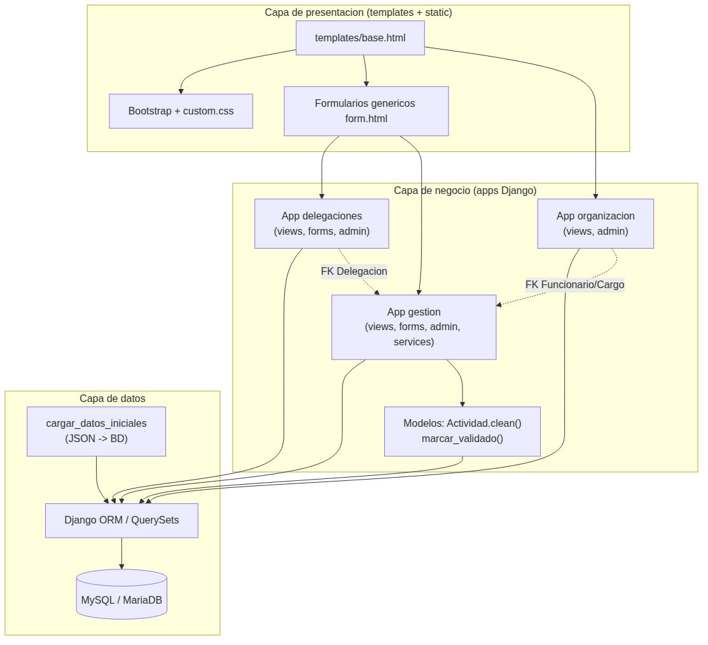
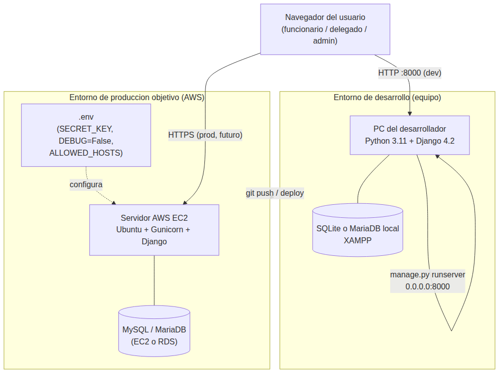

# Arquitectura de la solución — paradigma 4+1

Cubre los criterios **2.1.2.3** (vistas del paradigma 4+1) y **2.1.2.4**
(tecnologías y herramientas de infraestructura) de la rúbrica de
Evaluación 2. Describe el proyecto Django real conectado a MySQL/MariaDB
(el mismo proyecto fusionado que se usa en el ramo de Programación Back
End, tal como indicó el profesor Ciceo en clases).

## 2.1.2.3 — Las 5 vistas del paradigma 4+1

**Vista lógica** — tres aplicaciones Django con sus modelos:
`delegaciones` (`Delegacion`), `gestion` (`Categoria` y `Actividad`) y
`organizacion` (`CargoFuncion`, `Funcionario` y `MetaProyecto`,
incorporados al fusionar el trabajo de ambos integrantes del equipo).
`Actividad` se relaciona con `Delegacion`, `Categoria` y `Funcionario` (y
ahora también con `Funcionario` como `validado_por`, para la validación
de actividades); `Funcionario` se relaciona con `Delegacion` y
`CargoFuncion`; `MetaProyecto` se relaciona con `CargoFuncion`. El detalle
completo, con el tipo exacto de cada relación, está en
`DIAGRAMA_CLASES.md`.

**Vista de desarrollo** — el sistema se organiza en tres capas: capa de
presentación (templates de Django con Bootstrap, paleta institucional de
la Municipalidad de La Serena); capa de lógica de negocio (`views.py` y
`forms.py` de cada app, más `services.py` para las agregaciones del
resumen de gestión), construida sobre el ORM de Django; capa de datos
(MySQL/MariaDB, accedida solo mediante el ORM, sin SQL escrito a mano,
usando PyMySQL como driver). Diagrama de componentes del proyecto real
(las tres apps Django y cómo se comunican entre capas):

**Vista de procesos** — flujo real del sistema:
1. Se registra un `Funcionario` asociado a una `Delegacion` y a un
   `CargoFuncion`, con un rol de sistema (Funcionario, Delegado,
   Coordinador o Verificador).
2. Un Funcionario registra una `Actividad` (formulario real, no un
   marcador de posición), asignada a una Delegación, una Categoría y a sí
   mismo, con estado inicial "Pendiente".
3. El estado avanza a "En proceso" o "Realizado" a medida que se
   gestiona.
4. Un Funcionario con rol **Delegado** valida esa actividad desde su
   ficha de detalle (nunca el mismo Funcionario que la registró).
5. El administrador supervisa todo desde Django Admin, con acciones
   masivas (por ejemplo, "Marcar como validadas").

**Vista física** — en desarrollo, el sistema corre con el servidor de
Django (`runserver`) sobre un entorno local XAMPP (Apache + MariaDB) o
SQLite, según la variable `DB_ENGINE` del archivo `.env`. Para producción
está pensado un despliegue en una instancia AWS EC2 (Ubuntu) con MySQL,
tal como exige la Evaluación 2 del ramo de Programación Back End. Diagrama
de despliegue (entorno de desarrollo actual vs. el objetivo de
producción):

> Nota honesta: el entorno de producción en AWS EC2 es el **objetivo
> declarado**, alineado con lo que exige el ramo de Programación Back
> End — no está desplegado todavía. El sistema sí corre y se verificó de
> verdad en el entorno de desarrollo (ver `PROTOTIPO.md` y `TESTING.md`).

**Vista de escenarios (+1)** — por ejemplo, el escenario "Delegado valida
una actividad" recorre: la ficha de detalle (`gestion:detalle`) → el
formulario de validación (`ValidacionForm`) → la vista → el método
`Actividad.marcar_validado()` → la regla de negocio en
`Actividad.clean()` → la base de datos MySQL. Este escenario está cubierto
por pruebas automatizadas reales (ver `TESTING.md`).

## 2.1.2.4 — Tecnologías y herramientas de infraestructura

| Componente | Tecnología / herramienta | Justificación |
|---|---|---|
| Backend / framework | Python 3 + Django (>=4.2,<5.0) | Framework con ORM, autenticación y panel de administración incluidos; versión LTS por compatibilidad con el entorno de desarrollo y despliegue. |
| Motor de base de datos | MySQL / MariaDB (SQLite en desarrollo local) | Motor relacional estándar, administrable desde phpMyAdmin; ampliamente disponible. |
| Driver de base de datos | PyMySQL | Driver puro en Python; evita depender de compilar `mysqlclient` en Windows o EC2. |
| Configuración sensible | python-decouple + archivo `.env` | Separa credenciales y `SECRET_KEY` del código fuente (nunca se suben a GitHub). |
| Administración de datos | Django Admin | CRUD completo de todas las entidades, con `autocomplete_fields` entre relaciones y acciones masivas, sin desarrollar pantallas aparte. |
| Formularios públicos | Django Forms (`ModelForm`) | CRUD real de Delegación y Actividad desde la interfaz pública (no solo desde Admin). |
| Pruebas automatizadas | Django `TestCase` (`python manage.py test`) | Incluido en el framework; permite correr las 41 pruebas del proyecto antes de cada entrega o despliegue. |
| Control de versiones | Git / GitHub | Historial de commits del proyecto; necesario para que el equipo trabaje en paralelo. |
| Despliegue objetivo | AWS EC2 (Ubuntu) | Instancia en la nube requerida por la Evaluación 2 del ramo de Programación Back End. |
| Diagramado técnico | Mermaid (diagramas de clases, flujos) | Permite versionar los diagramas como texto junto al código, y regenerarlos cuando el modelo cambia (ver `DIAGRAMA_CLASES.md`). |
