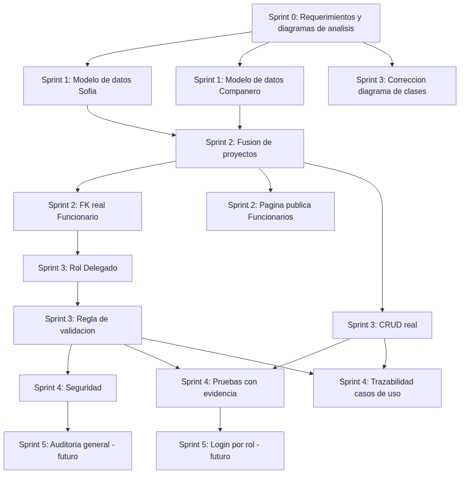
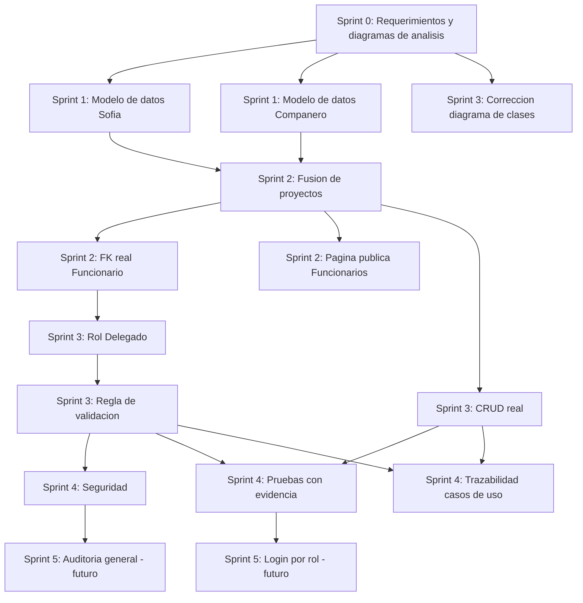

# Cronograma del proyecto — SGR La Serena

Cubre los criterios **2.1.1.1** (actividades y fases según una metodología)
y **2.1.1.2** (dependencias y prioridades entre tareas) de la rúbrica de
Evaluación 2.

## Metodología seleccionada: Scrum adaptado a un equipo de 2 personas

Se eligió **Scrum** porque el proyecto se construye de forma incremental
(cada Evaluación Sumativa agrega una capa funcional sobre la anterior:
diagnóstico → base de datos → fusión de equipos → roles/seguridad →
pruebas) y porque el "cliente" real (la Municipalidad de La Serena, a
través del caso entregado por los profesores) entrega retroalimentación
entre cada entrega, igual que un Product Owner revisa cada sprint.

Adaptación por tamaño de equipo (2 integrantes, Sofía Veliz y su
compañero de equipo):

| Rol Scrum | Quién lo cumple |
|---|---|
| Product Owner | El caso de negocio (Municipalidad) + retroalimentación de los profesores Ciceo (Proyecto Integrado) y Alex (Programación Back End) |
| Scrum Master | Rotativo entre ambos integrantes, según el sprint |
| Development Team | Sofía Veliz (apps `delegaciones`, `gestion`) + compañero de equipo (app `organizacion`: cargos, funcionarios, metas) |

Sprints de **1 semana**, con una reunión de cierre/retro al final de cada
uno (en la práctica: la sesión donde se revisa el avance con cada
profesor).

## Épicas del backlog

1. **Diagnóstico y requerimientos** — levantar necesidades TI, historias
   de usuario, requerimientos funcionales/no funcionales (Evaluación 1).
2. **Modelo de datos y base relacional** — migrar de JSON a base de datos
   real, con Django ORM.
3. **Fusión de equipo** — unificar el proyecto de Sofía con el del
   compañero en una sola base de código.
4. **Gestión de actividades con roles y validación** — jerarquía
   Administrador/Coordinador/Delegado/Funcionario y flujo de validación.
5. **Seguridad** — autenticación, control de acceso, buenas prácticas.
6. **Pruebas y documentación** — pruebas automatizadas, diagramas y
   trazabilidad para la entrega.

## Cronograma por sprint (fases, dependencias, prioridades y responsables)

| Sprint | Fase / actividad | Épica | Responsable | Prioridad | Depende de | Estado |
|---|---|---|---|---|---|---|
| Sprint 0 | Levantamiento de necesidades TI, historias de usuario, RF/RNF | 1 | Sofía + compañero | Alta | — | ✅ Hecho (Evaluación 1) |
| Sprint 0 | Diagramas de análisis: requerimientos, casos de uso, clases, MER, wireframes | 1 | Sofía + compañero | Alta | Levantamiento de necesidades | ✅ Hecho, con observaciones del profesor a corregir en Sprint 3 |
| Sprint 1 | Modelar `Delegacion` y `Actividad` como tablas reales (antes JSON) | 2 | Sofía | Alta | Diagramas de análisis | ✅ Hecho |
| Sprint 1 | Configurar base de datos MySQL + variables de entorno (`.env`) | 2 | Sofía | Alta | — | ✅ Hecho |
| Sprint 1 | Modelar `CargoFuncion`, `Funcionario`, `MetaProyecto` | 2 | Compañero | Alta | — (en paralelo con Sofía) | ✅ Hecho |
| Sprint 2 | Fusionar ambos proyectos en una sola base de código (`organizacion` + `delegaciones` + `gestion`) | 3 | Sofía | Alta | Sprint 1 completo (ambas partes) | ✅ Hecho |
| Sprint 2 | `Actividad.funcionario` de texto libre a relación real (FK) | 3 | Sofía | Media | Fusión de proyectos | ✅ Hecho |
| Sprint 2 | Página pública de Funcionarios + ajuste visual institucional | 3 | Sofía | Media | Fusión de proyectos | ✅ Hecho |
| Sprint 3 | Agregar rol `Delegado` y jerarquía de roles | 4 | Sofía | Alta | Fusión de proyectos | ✅ Hecho |
| Sprint 3 | Regla de validación (el Delegado valida, no el Funcionario que registró) | 4 | Sofía | Alta | Rol Delegado agregado | ✅ Hecho |
| Sprint 3 | CRUD real de Delegación y Actividad (antes "en construcción") | 4 | Sofía | Alta | Modelo de datos fusionado | ✅ Hecho |
| Sprint 3 | Corregir diagrama de clases (relaciones mal tipificadas, según feedback) | 1 (corrección) | Sofía | Alta | Retroalimentación del profesor Ciceo (Evaluación 1) | ✅ Hecho |
| Sprint 4 | Políticas de seguridad (autenticación, amenazas, estándares) | 5 | Sofía | Alta | Roles y validación implementados | ✅ Hecho (`SEGURIDAD.md`) |
| Sprint 4 | Pruebas unitarias e integrales, con evidencia de ejecución | 6 | Sofía | Alta | CRUD real + validación implementados | ✅ Hecho (41 pruebas, `TESTING.md`) |
| Sprint 4 | Tabla de trazabilidad de casos de uso | 6 | Sofía | Media | CRUD real + validación implementados | ✅ Hecho (`CASOS_DE_USO.md`) |
| Sprint 5 (futuro) | Login por rol fuera de Django Admin | 4 | Por asignar | Media | — | ⏳ Pendiente (declarado fuera de alcance actual) |
| Sprint 5 (futuro) | Bitácora/auditoría general del sistema | 5 | Por asignar | Baja | — | ⏳ Pendiente (declarado fuera de alcance actual) |

## Diagrama de dependencias (resumen visual)

Fuente editable (Mermaid) por si se necesita modificar:

## Priorización (criterio usado)

Se priorizó **Alta** todo lo que era prerrequisito técnico de otra tarea
(por ejemplo, no se puede validar actividades sin que exista primero el
rol Delegado), y **Media/Baja** lo que mejora el sistema pero no bloquea
a otras tareas (por ejemplo, la bitácora de auditoría general es una
mejora futura, no bloquea nada de lo ya entregado).
