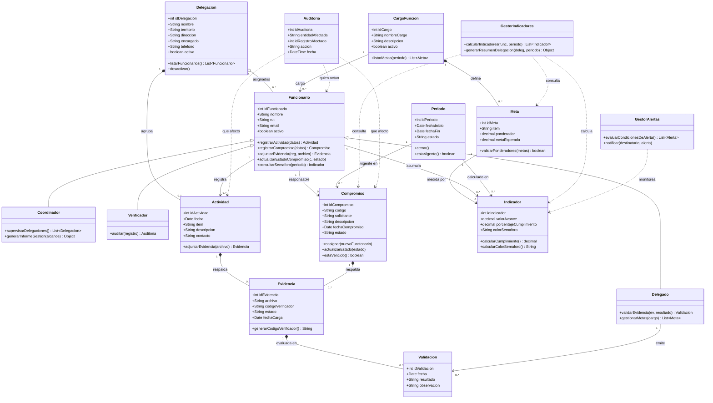
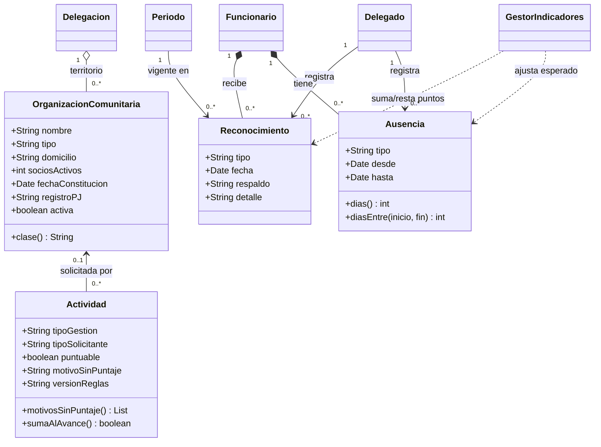
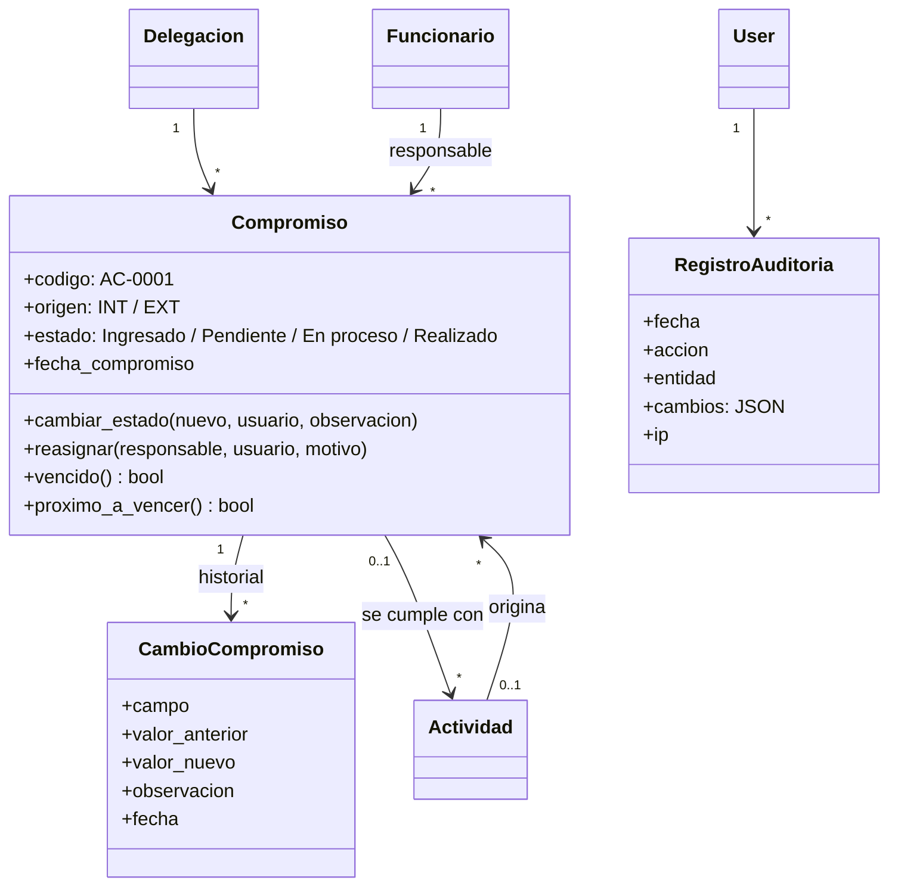

# Diagrama de clases — SGR La Serena

Este diagrama mantiene la **misma estructura y las mismas 13 clases** del
diagrama entregado en la Evaluación 1 (Delegación, CargoFunción,
Funcionario, Periodo, Meta, Actividad, Compromiso, Evidencia, Validación,
Indicador, Auditoría, GestorIndicadores, GestorAlertas). Lo que se corrige
aquí es exactamente lo que el profesor Ciceo señaló en su audio: **el tipo
de cada relación** (si es asociación, agregación, composición o
dependencia) y **cómo se diferencian las funciones del Delegado y del
Funcionario** sin duplicar toda la estructura.

> Nota importante: este diagrama es el diseño completo para la evaluación
> de Caiceo (igual que el de la Evaluación 1). El proyecto Django real
> (para el ramo de Alex) implementa una versión más simple de este mismo
> modelo — eso ya se conversó y está bien así; son dos entregables
> distintos para dos ramos distintos.

Imagen ya renderizada: `docs_ia/diagrama_clases.png`.

## El diagrama

## Por qué el Delegado no duplica la estructura (herencia)

El profesor explicó que el Delegado "entra a la misma estructura gráfica
del Funcionario, pero con la diferencia de que no puede modificar nada
excepto la columna de validación". Eso en UML se modela con
**herencia/especialización**: `Delegado`, `Coordinador` y `Verificador`
**heredan** de `Funcionario` (triángulo hueco `<|--`). Esto quiere decir:

- Los tres tienen automáticamente todos los atributos y métodos base de
  `Funcionario` (nombre, rut, email, registrar actividad, etc.) — **la
  misma estructura/pantalla**, tal como pidió el profesor.
- Cada uno además **agrega solo lo que le corresponde**: el Delegado suma
  `validarEvidencia()` y `gestionarMetas()`; el Coordinador suma
  `supervisarDelegaciones()`; el Verificador suma `auditar()`. Ninguno
  "comparte" funciones que no le corresponden, que era justo la confusión
  que el profesor marcó en los casos de uso ("no pueden tener las mismas
  funciones").

## Justificación de cada tipo de relación

El profesor dijo textualmente que tenía dudas con las relaciones —si eran
"inyección de dependencia, agregación o composición"—. Esta tabla responde
eso, relación por relación:

| Relación | Tipo UML | Por qué |
|---|---|---|
| Delegación → Funcionario | **Agregación** (◇) | El funcionario pertenece organizacionalmente a una delegación, pero no es "parte física" de ella — conceptualmente podría reasignarse a otra. |
| CargoFunción → Funcionario | **Asociación** | Es solo la clasificación/cargo que ocupa el funcionario, no una relación de todo‑parte. |
| CargoFunción → Meta | **Composición** (♦) | Una Meta se define específicamente para un Cargo; si el cargo deja de existir, sus metas no tienen sentido por sí solas (en el proyecto Django real esto es literalmente `on_delete=CASCADE`). |
| Delegación → Actividad | **Composición** (♦) | Si se elimina la delegación, sus actividades se eliminan con ella (igual que en el código real, `on_delete=CASCADE`). |
| Funcionario → Actividad | **Asociación** ("registra") | El funcionario registra actividades, pero la actividad no es "parte" del funcionario — son entidades independientes relacionadas entre sí. |
| Funcionario → Compromiso | **Asociación** ("responsable") | Misma lógica: relación de responsabilidad, no de todo‑parte. |
| Actividad/Compromiso → Evidencia | **Composición** (♦) | Una evidencia no tiene ningún sentido sin la actividad o compromiso que respalda; si se borra uno, se borra su evidencia. |
| Evidencia → Validación | **Composición** (♦) | La validación es un juicio sobre *esa* evidencia puntual; no existe de forma independiente. |
| Delegado → Validación | **Asociación** ("emite") | El Delegado emite validaciones, pero no es "dueño" estructural de ellas — por eso asociación y no composición. Esta es la relación donde se aplica la regla: el Delegado nunca puede ser el mismo Funcionario que registró la Actividad/Evidencia que está validando. |
| Meta / Funcionario / Periodo → Indicador | **Asociación** | El indicador se calcula a partir de estos datos y los conserva como referencia, pero no los "posee". |
| GestorIndicadores / GestorAlertas → Indicador, Compromiso, Meta | **Dependencia** (- ‑>) | Son clases de servicio: usan temporalmente estas clases para calcular o avisar, pero no las guardan como atributo propio — son solo parámetros de sus métodos (`calcularIndicadores(func, periodo)`, etc.). |
| Auditoría → Funcionario / Actividad / Compromiso | **Dependencia** (- ‑>) | Auditoría no tiene una FK fija hacia estas clases: tiene `entidadAfectada` + `idRegistroAfectado` genéricos, aplicables a cualquier tabla. Por eso es dependencia (relación genérica/dinámica) y no asociación (relación fija y tipada). |

## Qué significa cada símbolo

- **Línea simple → (asociación)**: dos clases están relacionadas, pero
  cada una puede existir sin la otra.
- **◇ Agregación**: relación de "todo‑parte" débil — la parte podría
  existir o moverse independientemente del todo.
- **♦ Composición**: relación de "todo‑parte" fuerte — si se borra el
  todo, se borra la parte; la parte no tiene sentido sola.
- **- ‑> Dependencia (línea punteada)**: una clase usa a otra solo
  momentáneamente (por ejemplo, como parámetro de un método), sin guardar
  una referencia permanente.
- **▷ Herencia (triángulo hueco)**: una clase hereda todos los atributos y
  métodos de otra, y además agrega los suyos propios.

## Ampliación de la versión 2.0 (Nuevos requerimientos, octubre 2026)

La versión 2.0 no cambia las 13 clases anteriores. Agrega **3 clases** y algunos atributos a `Actividad`. Detalle de cada requisito en `REQUISITOS_V2.md`.

| Relación | Tipo | Justificación |
|---|---|---|
| Delegación → OrganizaciónComunitaria | Agregación | La organización existe en el territorio de la delegación, pero tiene vida propia: si se reorganizan las delegaciones, la organización sigue existiendo. En la base de datos es PROTECT. |
| Actividad → OrganizaciónComunitaria | Asociación opcional (0..1) | Solo algunas actividades las solicita una organización. Si la organización se elimina, la actividad se conserva sin solicitante (SET_NULL). |
| Funcionario → Reconocimiento / Ausencia | Composición | Una felicitación o una ausencia no tiene sentido sin el funcionario al que pertenece (CASCADE). |
| Delegado → Reconocimiento / Ausencia | Asociación | El Delegado es quien las registra (`registrado_por`), igual que con la Validación. |
| GestorIndicadores → Reconocimiento / Ausencia | Dependencia | Los usa para calcular el cumplimiento (+10 / −20) y la meta esperada, pero no los almacena. |

## Ampliación de la versión 2.1 (alcance mínimo de la Guía SGR)

Las clases de la agenda colectiva y de la auditoría ya están **implementadas**. Detalle de los campos en `MODELO_DATOS.md`.

