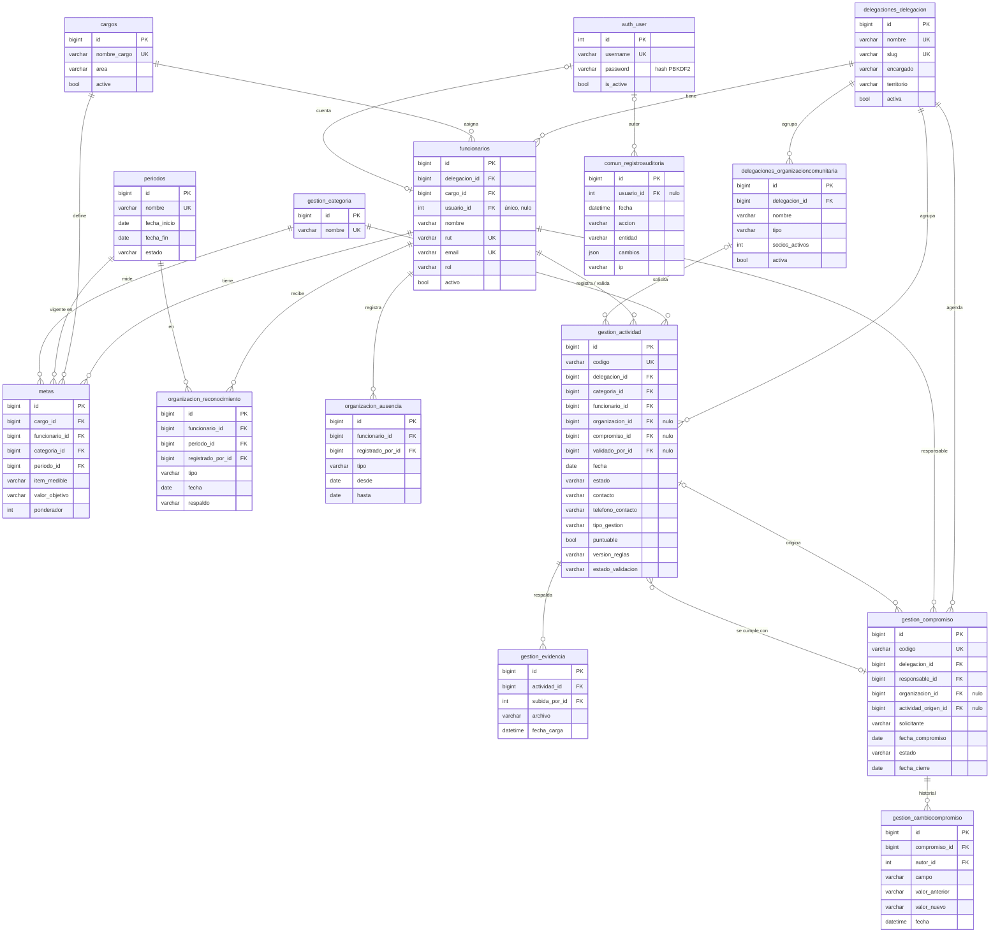

# Modelo de datos — SGR La Serena

Cubre los criterios **2.1.4.8** (entidades y relaciones) y **2.1.4.9**
(bases estructuradas y no estructuradas) de la rúbrica de Evaluación 2.

## Modelo entidad-relación actualizado (versión 2.2.2)

Son las 15 tablas tal como están en MariaDB, con sus claves primarias (PK), foráneas (FK) y únicas (UK). Imagen: `docs/diagramas/mer.png`.



## 2.1.4.8 — Entidades y relaciones

El modelo de datos conceptual completo (13 clases, con el tipo exacto de
cada relación — asociación, agregación, composición, dependencia,
herencia — y la justificación de cada una) está en `DIAGRAMA_CLASES.md`.
Esta sección documenta el **modelo relacional real**, tal como existe hoy
en la base de datos MySQL/MariaDB del proyecto Django (la versión
efectivamente implementada y verificada con pruebas automatizadas):

| Entidad | Campos clave | Relación |
|---|---|---|
| `Delegacion` | `nombre` (único), `slug`, `encargado`, `dirección`, `teléfono`, `email`, `territorio`, `enfoque` | Entidad base; referenciada por `Actividad` y por `Funcionario`. |
| `Categoria` | `nombre` (único), `descripción` | Catálogo de categorías de actividad. |
| `CargoFuncion` | `nombre_cargo` (único), `descripción`, `vigente` | Catálogo de cargos municipales. |
| `Funcionario` | `nombre`, `rut` (único), `email` (único), `rol` (Funcionario / Delegado / Coordinador / Verificador) | FK → `Delegacion` (RESTRICT), FK → `CargoFuncion` (RESTRICT). |
| `MetaProyecto` | `ítem medible`, `valor objetivo`, `unidad`, `ponderador` | FK → `CargoFuncion` (CASCADE). |
| `Actividad` | `código` (único), `fecha`, `descripción`, `estado`, `solicitud_problema`, `contacto`, `teléfono_contacto`, **`validado`, `validado_por`, `fecha_validacion`** | FK → `Delegacion` (CASCADE), FK → `Categoria` (PROTECT), FK → `Funcionario` (PROTECT), FK → `Funcionario` como `validado_por` (PROTECT, solo rol Delegado). |

### Cambios del modelo en la versión 2.0 (Nuevos requerimientos, octubre 2026)

| Entidad | Campos clave | Relación |
|---|---|---|
| `OrganizacionComunitaria` (**nueva**) | `nombre`, `tipo` (Junta de Vecinos territorial, o funcional: Adulto Mayor, Deportiva, Centro de Madres, Cultural, Juvenil, Comités), `domicilio`, `socios_activos`, `fecha_constitucion`, `registro_pj`, `activa` | FK → `Delegacion` (PROTECT). Nombre único por delegación. |
| `Reconocimiento` (**nueva**) | `tipo` (Felicitación / Reclamo), `fecha`, `respaldo` (correo, WhatsApp o libro al Delegado, carta), `detalle` | FK → `Funcionario` (CASCADE), FK → `Periodo` (PROTECT), FK → `Funcionario` como `registrado_por` (solo Delegado). |
| `Ausencia` (**nueva**) | `tipo` (licencia, vacaciones, administrativo, libre), `desde`, `hasta`, `observacion` | FK → `Funcionario` (CASCADE), FK → `Funcionario` como `registrado_por` (solo Delegado). |
| `Actividad` (campos **nuevos**) | `tipo_gestion` (realización / previa), `tipo_solicitante` (vecino / organización / Delegado), `puntuable`, `motivo_sin_puntaje`, `version_reglas` ("1.0" o "2.0") | FK → `OrganizacionComunitaria` como `organizacion` (SET_NULL, opcional). |

`puntuable` y `motivo_sin_puntaje` no los escribe el usuario: se calculan al guardar con las reglas de la versión indicada en `version_reglas`. Las actividades que ya existían al migrar quedaron como `"1.0"`, así que su puntaje no cambia (ver `REQUISITOS_V2.md`, RF-048).

### Cambios del modelo en la versión 2.1 (alcance mínimo de la Guía)

| Entidad | Campos clave | Relación |
|---|---|---|
| `Compromiso` (**nueva**, agenda colectiva) | `codigo` (AC-0001), `origen` (INT/EXT), `solicitante`, `territorio`, `descripcion`, `area_apoyo`, `fecha_solicitud`, `fecha_compromiso`, `estado` (Ingresado/Pendiente/En proceso/Realizado), `observacion`, `fecha_cierre` | FK → `Delegacion` (PROTECT), FK → `Funcionario` como `responsable` (PROTECT), FK → `OrganizacionComunitaria` (SET_NULL), FK → `Actividad` como `actividad_origen` (SET_NULL) |
| `CambioCompromiso` (**nueva**, historial) | `campo` (Estado/Responsable), `valor_anterior`, `valor_nuevo`, `observacion`, `fecha` | FK → `Compromiso` (CASCADE), FK → `User` como `autor` |
| `RegistroAuditoria` (**nueva**, app `comun`) | `fecha`, `usuario_texto`, `accion`, `entidad`, `objeto_id`, `objeto`, `cambios` (JSON: valor anterior → valor nuevo), `detalle`, `ip` | FK → `User` (SET_NULL). No se puede modificar ni eliminar |
| `Actividad` (campo **nuevo**) | `compromiso` | FK → `Compromiso` (SET_NULL): el compromiso que la actividad cumple |

El campo `cambios` de la auditoría es un **dato semiestructurado** (JSON), porque cada tabla tiene campos distintos. Se guarda dentro de la base relacional, como se describe en la sección 2.1.4.9.

Las restricciones de borrado (`on_delete`) se eligieron según el
significado real de cada relación:

- **CASCADE** donde el dato dependiente no tiene sentido sin su padre
  (al borrar una `Delegacion` se borran sus `Actividad`; al borrar un
  `CargoFuncion` se borran sus `MetaProyecto`).
- **PROTECT** donde se debe conservar historial (no se puede borrar una
  `Categoria` o un `Funcionario` que ya tiene `Actividad` registradas, ni
  un Delegado que ya validó actividades).
- **RESTRICT** donde una entidad de catálogo no puede eliminarse mientras
  esté en uso (un `Funcionario` no puede quedar sin `Delegacion` ni sin
  `CargoFuncion`).

Estas reglas están verificadas con pruebas automatizadas reales, no solo
documentadas (ver `TESTING.md`): por ejemplo
`test_no_se_puede_borrar_funcionario_en_uso` confirma que intentar borrar
un Funcionario con actividades asociadas lanza una excepción real contra
la base de datos.

## 2.1.4.9 — Bases estructuradas y no estructuradas

El sistema combina dos formas de datos:

**Estructurados**: todas las tablas relacionales de MySQL/MariaDB
listadas arriba, accedidas exclusivamente a través del ORM de Django
(nunca con SQL escrito a mano). Esta es la fuente de verdad del sistema
en producción.

**Semiestructurados** (de origen): los archivos JSON originales de la
Evaluación 1 (`data/delegaciones.json` y `data/actividades.json`). Estos
JSON ya **no se leen en tiempo de ejecución** — se usan como fuente de
carga inicial a través del comando `cargar_datos_iniciales`, que los
transforma y los inserta en las tablas relacionales. Esto combina una
fuente de datos flexible (JSON, sin esquema fijo) con la robustez e
integridad referencial de un modelo relacional final.

Ejemplo real de esa transformación (de JSON semiestructurado a fila
relacional estructurada), tal como lo hace
`gestion/management/commands/cargar_datos_iniciales.py`:

```json
{"codigo": "RUR-001", "delegacion": "Rural", "funcionario": "M. Soto (ejemplo)", "estado": "Realizado"}
```

se convierte en una fila de la tabla `Actividad` con `delegacion_id` y
`funcionario_id` apuntando a las filas reales de `Delegacion` y
`Funcionario` (resueltas por nombre al momento de la carga), con
integridad referencial garantizada por MySQL desde ese momento en
adelante.
