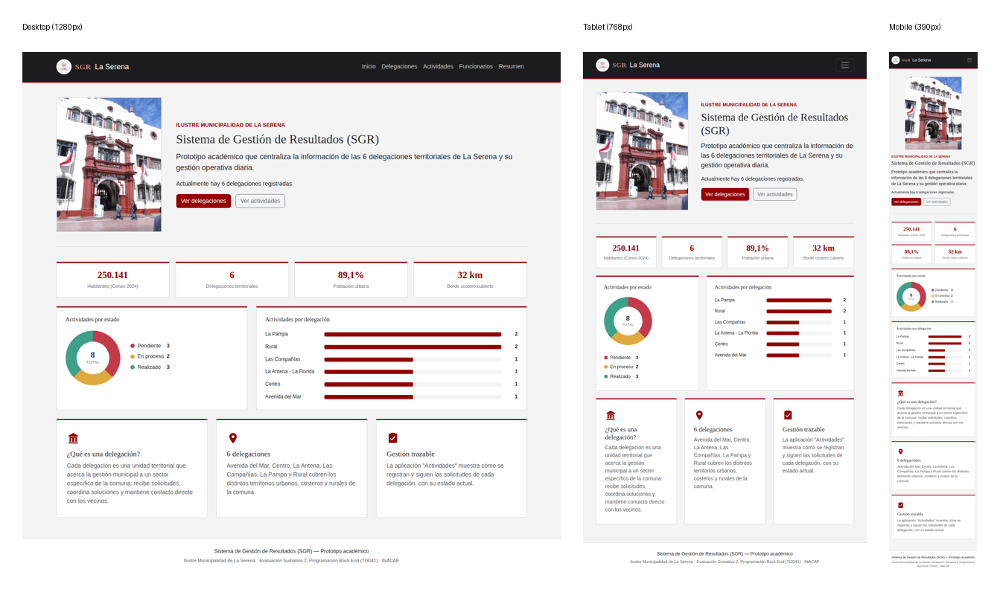

# Prototipo interactivo — SGR La Serena

Cubre los criterios **2.1.3.5** (prototipo interactivo funcional),
**2.1.3.6** (consistencia visual y adaptabilidad) y **2.1.3.7**
(integración de retroalimentación de usuarios) de la rúbrica de
Evaluación 2.

## 2.1.3.5 — Prototipo interactivo funcional

A diferencia de un mockup estático (por ejemplo en Figma, sin lógica
real), el prototipo de este proyecto **es la aplicación Django real,
funcionando contra una base de datos**. Esto cumple el criterio con un
nivel más alto de evidencia: no solo se "ve" la interfaz, se puede
**interactuar** con ella de verdad —buscar, filtrar, crear, modificar,
eliminar, validar— y los cambios efectivamente quedan guardados.

Flujos interactivos verificados de punta a punta (ver también
`CASOS_DE_USO.md` para el detalle de cada uno):

| Flujo | Dónde se prueba |
|---|---|
| Buscar y filtrar delegaciones/actividades | `/delegaciones/`, `/gestion/` (campo de búsqueda + filtro por estado) |
| Registrar una actividad nueva | `/gestion/nueva/` (formulario real, guarda en la base de datos) |
| Modificar / eliminar con confirmación | botones "Modificar"/"Eliminar" en cada ficha |
| Validar una actividad (regla del Delegado) | ficha de detalle de una actividad pendiente, `/gestion/<id>/` |
| Navegar el listado de Funcionarios | `/organizacion/funcionarios/` |

Cómo levantarlo y probarlo tú misma: `python manage.py runserver` y
abrir `http://127.0.0.1:8000/` (comandos completos en el `README.md`).

## 2.1.3.6 — Consistencia visual y adaptabilidad

Se verificó la adaptabilidad con capturas reales del sitio en **tres
anchos de pantalla** (no solo se afirma que "es responsive" — se probó):

- Escritorio (1280px): menú horizontal completo.
- Tablet (768px): menú colapsado en botón hamburguesa, tarjetas en 2
  columnas.
- Celular (390px): una sola columna, todo legible sin hacer zoom.

**Bug real encontrado y corregido durante esta verificación**: la
portada (`.hero`, foto + texto de bienvenida) usaba `flex-wrap: nowrap`
en el CSS, lo que forzaba la foto y el texto a quedar en una sola fila
incluso en una pantalla de celular — el texto quedaba apretado en una
columna angosta e ilegible. Se agregó una regla `@media (max-width:
767.98px)` en `static/css/custom.css` para que la foto y el texto se
apilen verticalmente en pantallas angostas. Esto es evidencia real de
"adaptabilidad verificada", no solo declarada: se encontró un problema
real probando en el tamaño de pantalla correspondiente, y se corrigió.

Toda la interfaz comparte, en los tres tamaños, la misma identidad
visual institucional: rojo institucional (`#920000`), tipografía Georgia
para títulos, tarjetas blancas con borde superior rojo, y la misma
estructura de navegación (Inicio / Delegaciones / Actividades /
Funcionarios / Resumen).

## 2.1.3.7 — Integración de retroalimentación de usuarios

A diferencia de un plan "propuesto" para recoger retroalimentación más
adelante, aquí hay un **registro real** de retroalimentación ya
recibida (de Sofía, como usuaria/dueña del producto) e **integrada** en
el diseño durante el desarrollo:

| Retroalimentación recibida | Cambio aplicado |
|---|---|
| "No me gusta cómo se ve esta tabla [de Funcionarios]" | Se rediseñó la tabla: tarjeta blanca con borde institucional, avatares con inicial del nombre, badges de rol en vez de texto plano. |
| "Pone Resumen al último y al lado de Actividades pone Funcionarios" | Se reordenó el menú de navegación: Inicio / Delegaciones / Actividades / Funcionarios / Resumen. |
| "Saca esa raya negra [encabezado de tabla] y cambia el color anaranjado/amarillo feo" | Encabezado de tabla cambiado a color crema institucional; color del badge "Coordinador" cambiado de ámbar a azul acero (`#3E6E8E`). |
| (verificación propia, no reportada por un usuario) texto de la portada ilegible en celular | Corregido el `flex-wrap` del hero para que se adapte a pantallas angostas (ver 2.1.3.6). |

Este registro completo, con fecha, también está guardado en el
documento de seguimiento del proyecto para dejar trazabilidad de cada
cambio pedido y aplicado.
